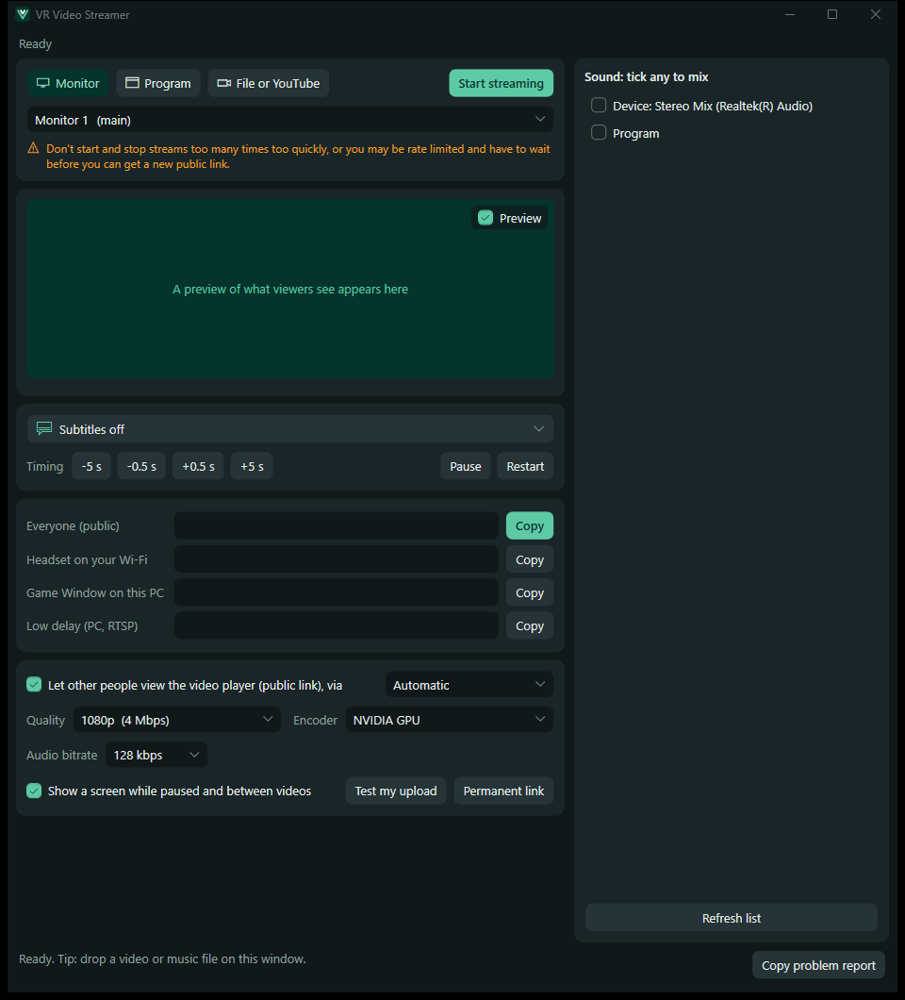

# VR Video Streamer

Stream your desktop, application windows, local video files and online videos to VR video players.

**[Download the latest version](https://github.com/Kubi-Cle/VR-Video-Streamer/releases/latest)**

## Features

- Stream a monitor, a program, a video or music file, or an online video
- Search YouTube and queue videos while you're streaming
- Find subtitles online or generate them with AI
- Share a public link, with a live preview of what viewers see

## Get started

Needs Windows 10 (version 2004 or newer) or Windows 11, 64-bit.

1. Download `VR-Video-Streamer-1.1.0.zip` from the link above and extract it.
2. Open `VR Video Streamer.exe`. It offers to download FFmpeg, the video tool it needs, on first run.
3. Press **Start streaming** and paste the public link into a video player in your VR game.

Windows may show a warning because the program isn't digitally signed. [`README.txt`](README.txt) has the full steps and troubleshooting.

Only stream what you have the right to share. Viewers can see everything on the screen or window you stream, including passwords and notifications, and public links pass through a third-party service.

Need help? Press **Copy problem report** in the program and paste it into a [new issue](https://github.com/Kubi-Cle/VR-Video-Streamer/issues).

## Licence

Free for noncommercial use under the [PolyForm Noncommercial License 1.0.0](LICENSE). Bundled and downloaded tools keep their own licences, listed in [`THIRD-PARTY-NOTICES.txt`](THIRD-PARTY-NOTICES.txt).
